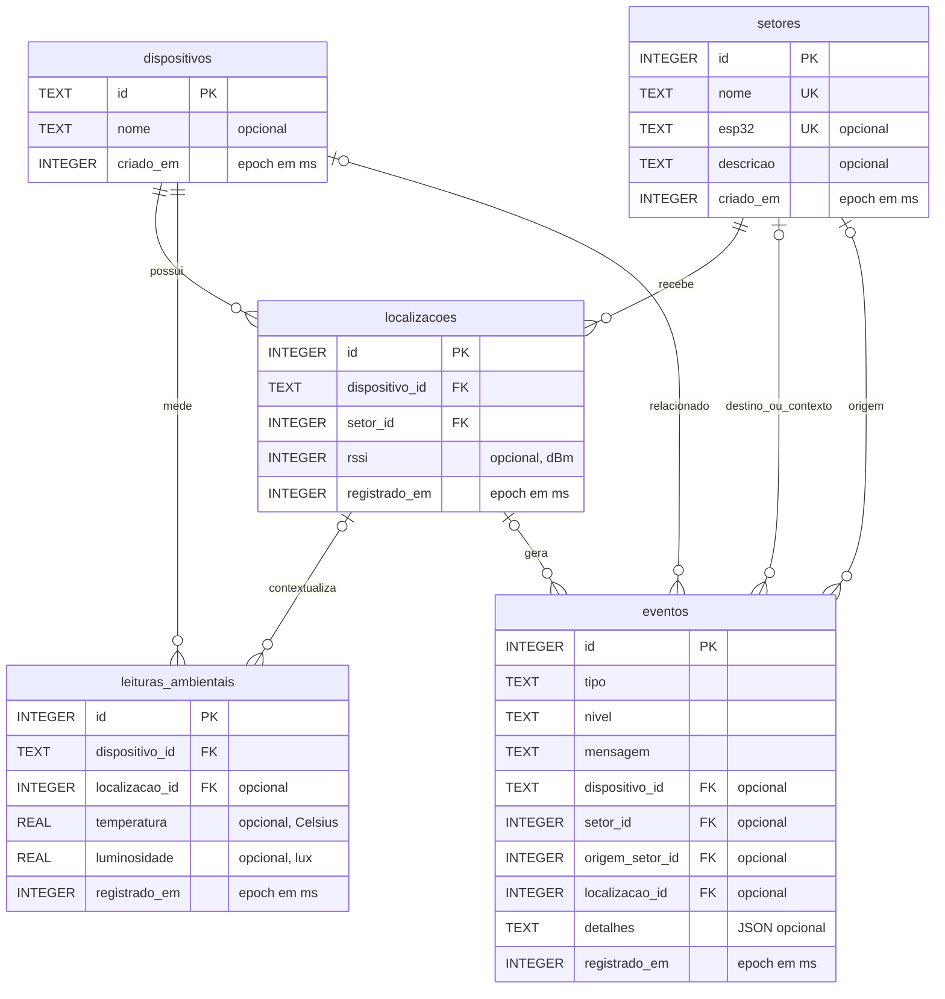

# Banco de dados e API do AquiIoT

O backend persiste dispositivos, setores, detecções, leituras ambientais e eventos em SQLite. A interface continua utilizando os endpoints existentes, agora com dados duráveis e datas completas. Um banco novo começa vazio: não há dispositivos, setores, leituras ou eventos de demonstração.

## Decisões e execução na Raspberry Pi

SQLite mantém os dados em um arquivo local e dispensa um servidor de banco separado. O backend utiliza `node:sqlite`, incluído no **Node.js 24 ou superior**, com Express. Na Raspberry Pi, instale uma distribuição de Node.js compatível com o sistema operacional e a arquitetura da placa; o projeto não depende de módulos SQLite compilados pelo npm.

Execute a partir da raiz do repositório:

```bash
node --version
npm --prefix backend ci
npm --prefix backend run db:init
npm --prefix backend start
```

`db:init` é opcional: a inicialização do servidor também cria o diretório, abre o banco e aplica as migrações pendentes. A interface é executada separadamente com `npm run dev`, conforme [frontend.md](frontend.md).

| Variável do backend | Padrão | Finalidade |
|---|---|---|
| `DATABASE_PATH` | `backend/data/aquiiot.sqlite` | Arquivo SQLite; prefira um caminho absoluto na Raspberry Pi. |
| `PORT` | `3000` | Porta HTTP, de 1 a 65535. |
| `HOST` | `0.0.0.0` | Endereço de escuta do servidor. |
| `OFFLINE_AFTER_MS` | `120000` | Intervalo sem detecção para considerar um dispositivo offline, em milissegundos; inteiro positivo. |

O backend **não carrega arquivos `.env` automaticamente**. Exporte as variáveis no terminal ou configure-as no serviço que inicia o Node.js:

```bash
export DATABASE_PATH=/home/pi/aquiiot-data/aquiiot.sqlite
export PORT=3000
export HOST=0.0.0.0
export OFFLINE_AFTER_MS=120000
npm --prefix backend start
```

O usuário do serviço precisa de permissão de escrita no diretório do banco, incluindo os arquivos auxiliares SQLite. Use armazenamento local persistente. Configure o relógio da Raspberry Pi, pois ele é a referência temporal dos registros. 

## Modelo de dados

O esquema está em [`backend/database/migrations/001_initial.sql`](../backend/database/migrations/001_initial.sql).



- **Dispositivos:** identificador do chaveiro, nome opcional e data de descoberta. O identificador é a chave primária.
- **Setores:** nome único, identificador opcional e único do ESP32 responsável, descrição e data de criação. Um setor descoberto pela primeira detecção não recebe um ESP32 inventado; essa associação pode ser configurada depois.
- **Localizações:** cada detecção recebida, com dispositivo, setor, RSSI opcional e horário. O último registro de cada dispositivo determina seu último setor conhecido.
- **Leituras ambientais:** temperatura e/ou luminosidade de um dispositivo, vinculadas à localização quando disponível. Pelo menos um sensor deve estar preenchido. Leituras parciais são permitidas.
- **Eventos:** detecções, movimentações, recebimento de leituras e eventos gerais do sistema. As relações opcionais mantêm o contexto disponível; informações ausentes são `null`.

As tabelas usam `STRICT`, chaves estrangeiras e restrições de integridade. As relações usam `ON DELETE RESTRICT` para impedir exclusões que deixem históricos órfãos. `detalhes` armazena JSON válido; a API aceita um objeto e devolve o objeto desserializado.

Os índices de localização por dispositivo/data e setor/data atendem ao último setor e aos históricos. Leituras têm índices por dispositivo/data e localização. Eventos têm índices por data, dispositivo/data, setor/data, localização e origem. O desempate das consultas usa o `id`, inclusive quando dois registros têm o mesmo milissegundo.

Não há uma coluna persistida de status online. O backend calcula o status com o tempo da última **detecção de localização** e `OFFLINE_AFTER_MS`; uma leitura ambiental isolada não altera esse status. Dispositivos offline continuam associados ao último setor conhecido. Isso representa a última observação, não uma confirmação de presença atual. A expiração do status não cria automaticamente um evento de desconexão.

## Horários e unidades

`criado_em` e `registrado_em` são inteiros Unix epoch em **milissegundos UTC**, atribuídos pelo servidor ao receber a requisição. Localização, evento e sensores enviados juntos recebem o mesmo instante, dentro de uma transação. A API devolve `data` em ISO 8601 UTC, por exemplo `2026-10-23T15:30:00.000Z`. Os campos legados `horario` e `ultimaAtualizacao` continuam em `HH:mm:ss`, no fuso `America/Sao_Paulo`, para compatibilidade com a interface.

O payload atual não aceita um horário de aquisição do firmware como fonte temporal: dados retransmitidos são datados pelo recebimento. Caso seja necessário distinguir aquisição e recebimento, isso exige um novo campo e uma migração futura; datas enviadas por clientes não substituem o horário do servidor.

O contrato dos sensores é **temperatura em °C** e **luminosidade em lux**, ambos números JSON finitos. RSSI é um inteiro de **−127 a 0 dBm** ou ausente. Luminosidade deve ser maior ou igual a zero. O firmware ou o gateway deve converter e calibrar valores brutos, como ADC de um LDR, antes de enviar `luminosidade`; a API não converte ADC para lux. Se a medição não estiver disponível ou não tiver sido normalizada, omita o campo ou envie `null`, nunca um valor fictício.

## Persistência, migrações e backup

`backend/database/index.js` aplica os arquivos `.sql` em ordem, registrando cada versão em `schema_migrations` com seu horário. Cada migração é executada em transação. Não edite uma migração já aplicada: adicione um novo arquivo numerado para alterar o esquema. Um banco com versão desconhecida pelo código é recusado para evitar abertura por uma versão incompatível do backend.

O banco usa chaves estrangeiras habilitadas, `busy_timeout=5000`, journal **WAL** e `synchronous=FULL`. Operações que gravam localização, evento e sensores são atômicas: falhas revertem a operação inteira. Reiniciar o servidor preserva os registros; os antigos exemplos em memória não são importados.

Para criar uma cópia consistente, inclusive com o servidor em execução, use a operação de backup do SQLite:

```bash
export DATABASE_PATH=/home/pi/aquiiot-data/aquiiot.sqlite
npm --prefix backend run db:backup -- /home/pi/backups/aquiiot-2026-10-23.sqlite
```

O destino deve ser um arquivo novo; o comando não sobrescreve backups anteriores. Não copie somente o arquivo principal enquanto o servidor estiver gravando, pois transações podem estar no arquivo `-wal`.

Para restaurar, **pare o backend e qualquer outro processo que esteja acessando esse banco**. Preserve o banco atual e os arquivos auxiliares `-wal`/`-shm`, se existirem, em outro diretório. Copie o backup consistente para o caminho configurado em `DATABASE_PATH`, ajuste as permissões para o usuário do serviço e reinicie com uma versão compatível do backend. Não mantenha arquivos auxiliares da base anterior ao lado do arquivo restaurado. Guarde cópias fora do cartão da Raspberry Pi e teste a restauração em um caminho separado.

## API

As respostas de listagem permanecem arrays JSON. Erros usam `{ "erro": "mensagem" }`; validações retornam `400`, referências ausentes `404` e conflitos de configuração `409`.

| Método e rota | Uso |
|---|---|
| `GET /api/dispositivos` | Dispositivos com último setor, status, RSSI, `ultimaAtualizacao` e `data`. |
| `GET /api/dispositivos/:id` | Informações de um dispositivo. |
| `GET /api/dispositivos/:id/localizacao` | Última localização conhecida, no mesmo formato do dispositivo. |
| `GET /api/dispositivos/:id/historico` | Detecções do dispositivo, mais recentes primeiro. |
| `GET /api/dispositivos/:id/leituras/ultima` | Último valor não nulo de cada sensor, com datas independentes. |
| `GET /api/setores` | Setores reais cadastrados ou descobertos. |
| `POST /api/setores` | Configurar setor e ESP32. Também completa um setor descoberto sem ESP32. |
| `GET /api/setores/:id/dispositivos` | Dispositivos cujo último setor conhecido é o setor indicado. |
| `POST /api/localizacao` | Registrar detecção; descobrir dispositivo e setor quando novos; gerar evento e, opcionalmente, gravar sensores. |
| `GET /api/localizacoes` | Histórico de detecções. |
| `POST /api/leituras` | Registrar temperatura e/ou luminosidade de um dispositivo existente. |
| `GET /api/leituras` | Histórico de leituras ambientais. |
| `GET /api/eventos` | Histórico de localização: eventos de detecção e movimentação, compatível com a interface. |
| `GET /api/eventos/sistema` | Todos os eventos, incluindo leituras e eventos gerais. |
| `POST /api/eventos` | Registrar evento geral, com contexto opcional. |

`POST /api/localizacao` preserva os campos `dispositivo`, `setor` e `rssi` do contrato anterior; sensores são opcionais. Não existe cadastro manual de dispositivos nem remoção/edição de históricos pela API. Dispositivos aparecem com a primeira detecção real.

Uma detecção inicial gera `deteccao` com origem `null`. Novas detecções no mesmo setor também geram `deteccao`, e a origem disponível é o setor observado anteriormente. Uma mudança de setor gera `movimentacao` com origem e destino. Todas as detecções são preservadas. RSSI ausente permanece `null` e deve aparecer como `—` na interface.

Leituras enviadas separadamente geram `leitura_ambiental` em `/api/eventos/sistema`; sensores enviados junto à localização pertencem ao evento da detecção. `deteccao`, `movimentacao` e `leitura_ambiental` são tipos reservados às rotas correspondentes e não podem ser enviados por `POST /api/eventos`. Eventos gerais aceitam `tipo`, `mensagem`, `nivel` (`info`, `aviso` ou `erro`), `dispositivo`, `setor` e `detalhes` opcionais; dispositivo e setor informados precisam existir. Registrar um alerta não aciona buzzer ou alto-falante.

### Filtros e paginação

As listagens de localizações, eventos e leituras e o histórico individual aceitam `dispositivo`, `setor`, `inicio`, `fim`, `limite` e `offset`. `setor` é o **nome exato** do setor; em eventos, corresponde ao destino/contexto, não à origem. `tipo` se aplica às listagens de eventos. No histórico individual, o dispositivo da URL prevalece.

`inicio` e `fim` são inclusivos e exigem ISO 8601 com zona, como `2026-10-23T00:00:00-03:00` ou `2026-10-23T03:00:00Z`. Datas sem horário ou sem zona são rejeitadas; `inicio` deve ser anterior ou igual a `fim`. Use codificação de URL, especialmente para o sinal `+` dos fusos.

As listagens históricas retornam até **1000 registros por padrão**, no máximo **10000** por requisição. `offset` começa em zero. Os resultados vêm em ordem decrescente de data e `id`. Para consultar páginas seguintes, aumente `offset`; não há envelope com total. Em consultas enquanto chegam dados, a paginação por offset pode repetir/deslocar registros; fixe `fim` quando precisar percorrer um intervalo estável. As listagens de dispositivos e setores não usam essa paginação.

### Exemplos de integração

Os nomes e valores abaixo são exemplos de payload; nada é inserido automaticamente. Executar os comandos POST grava esses dados no banco selecionado.

```bash
# Configuração do setor (opcional antes da primeira detecção).
curl -X POST http://localhost:3000/api/setores \
  -H 'Content-Type: application/json' \
  -d '{"nome":"Sala 01","esp32":"ESP32_SALA_01","descricao":"Ponto fixo da sala"}'

# Detecção enviada pelo ESP32/gateway, com leituras já normalizadas.
curl -X POST http://localhost:3000/api/localizacao \
  -H 'Content-Type: application/json' \
  -d '{"dispositivo":"CHAVEIRO_01","setor":"Sala 01","rssi":-58,"temperatura":24.3,"luminosidade":315}'

curl http://localhost:3000/api/dispositivos/CHAVEIRO_01/localizacao
curl http://localhost:3000/api/setores/1/dispositivos

# Uma leitura parcial mantém o último valor conhecido do outro sensor.
curl -X POST http://localhost:3000/api/leituras \
  -H 'Content-Type: application/json' \
  -d '{"dispositivo":"CHAVEIRO_01","temperatura":24.5}'

curl http://localhost:3000/api/dispositivos/CHAVEIRO_01/leituras/ultima

# Histórico filtrado; curl codifica os nomes e os fusos corretamente.
curl --get http://localhost:3000/api/dispositivos/CHAVEIRO_01/historico \
  --data-urlencode 'setor=Sala 01' \
  --data-urlencode 'inicio=2026-10-23T00:00:00-03:00' \
  --data-urlencode 'fim=2026-10-23T23:59:59.999-03:00' \
  --data-urlencode 'limite=100' --data-urlencode 'offset=0'

curl -X POST http://localhost:3000/api/eventos \
  -H 'Content-Type: application/json' \
  -d '{"tipo":"alerta","nivel":"aviso","mensagem":"Alerta recebido do chaveiro","dispositivo":"CHAVEIRO_01","detalhes":{"fonte":"gateway"}}'

curl 'http://localhost:3000/api/eventos?tipo=movimentacao&limite=100'
curl 'http://localhost:3000/api/eventos/sistema?limite=100&offset=0'
curl 'http://localhost:3000/api/leituras?dispositivo=CHAVEIRO_01&limite=100'
```

O identificador numérico de um setor deve ser obtido por `GET /api/setores`, em vez de assumir `1` fora deste exemplo.

A resposta de últimas leituras preserva a data de cada sensor: uma leitura posterior só de temperatura não apaga a luminosidade anterior. Um sensor nunca recebido é `null`:

```json
{
  "dispositivo": "CHAVEIRO_01",
  "temperatura": { "valor": 24.5, "data": "2026-10-23T15:31:00.000Z" },
  "luminosidade": { "valor": 315, "data": "2026-10-23T15:30:00.000Z" }
}
```

## Consultas SQL de referência

As consultas usam parâmetros vinculados (`:dispositivo`, `:setor_id`), nunca concatenação de entrada do usuário. Datas retornadas diretamente pelo SQL estão em epoch milissegundos; a API faz a conversão para ISO.

### Última localização de um chaveiro

```sql
SELECT d.id, d.nome, s.nome AS setor, l.rssi, l.registrado_em
FROM dispositivos d
LEFT JOIN localizacoes l ON l.id = (
  SELECT id FROM localizacoes
  WHERE dispositivo_id = d.id
  ORDER BY registrado_em DESC, id DESC LIMIT 1
)
LEFT JOIN setores s ON s.id = l.setor_id
WHERE d.id = :dispositivo;
```

### Histórico de setores percorridos

```sql
-- Cada observação, incluindo repetições no mesmo setor.
SELECT l.id, s.nome AS setor, l.rssi, l.registrado_em
FROM localizacoes l
JOIN setores s ON s.id = l.setor_id
WHERE l.dispositivo_id = :dispositivo
ORDER BY l.registrado_em DESC, l.id DESC;

-- Apenas mudanças de setor; a primeira detecção não é movimentação.
SELECT e.registrado_em, o.nome AS origem, s.nome AS destino, l.rssi
FROM eventos e
JOIN setores s ON s.id = e.setor_id
LEFT JOIN setores o ON o.id = e.origem_setor_id
LEFT JOIN localizacoes l ON l.id = e.localizacao_id
WHERE e.dispositivo_id = :dispositivo AND e.tipo = 'movimentacao'
ORDER BY e.registrado_em DESC, e.id DESC;
```

### Dispositivos cujo último setor é o setor consultado

```sql
SELECT d.id, d.nome, l.rssi, l.registrado_em
FROM dispositivos d
JOIN localizacoes l ON l.id = (
  SELECT id FROM localizacoes
  WHERE dispositivo_id = d.id
  ORDER BY registrado_em DESC, id DESC LIMIT 1
)
WHERE l.setor_id = :setor_id
ORDER BY d.id;
```

Para restringir a dispositivos online, acrescente `AND l.registrado_em > :agora_ms - :offline_after_ms`, usando os mesmos valores do servidor.

### Última medição de cada sensor

```sql
-- Execute para temperatura; a data pertence a esse valor específico.
SELECT temperatura AS valor, registrado_em
FROM leituras_ambientais
WHERE dispositivo_id = :dispositivo AND temperatura IS NOT NULL
ORDER BY registrado_em DESC, id DESC LIMIT 1;

-- Consulte luminosidade independentemente: a última linha pode ser parcial.
SELECT luminosidade AS valor, registrado_em
FROM leituras_ambientais
WHERE dispositivo_id = :dispositivo AND luminosidade IS NOT NULL
ORDER BY registrado_em DESC, id DESC LIMIT 1;
```

### Histórico de eventos do sistema

```sql
SELECT e.id, e.tipo, e.nivel, e.mensagem, e.dispositivo_id,
       o.nome AS origem, s.nome AS setor, e.detalhes, e.registrado_em
FROM eventos e
LEFT JOIN setores s ON s.id = e.setor_id
LEFT JOIN setores o ON o.id = e.origem_setor_id
ORDER BY e.registrado_em DESC, e.id DESC
LIMIT 100 OFFSET 0;
```

## Validação

```bash
npm --prefix backend test
npm run lint
npm run build
```

Os testes usam bases temporárias ou em memória, sem gravar no banco de produção.
Eles verificam persistência após reabertura, migrações idempotentes, integridade
referencial, rollback, filtros, origem/destino, sensores parciais, expiração de
status, contratos HTTP e backup consistente com WAL ativo.

## Escopo atual e evolução

A estrutura permite integrar ESP8266 → ESP32 → backend na Raspberry Pi → frontend mantendo os contratos existentes. Não implementa provisionamento de dispositivos, autenticação, atuação remota, fila de mensagens do firmware, retenção automática de históricos ou importação dos antigos dados em memória. Esses recursos devem ser adicionados com contratos explícitos e migrações quando necessários. Para uma carga maior de dispositivos, meça a frequência de escrita e o crescimento do histórico antes de definir retenção ou migrar para outro banco.

## Referências técnicas

- [SQLite: aplicações embarcadas e IoT](https://www.sqlite.org/whentouse.html).
- [API SQLite do Node.js 24](https://nodejs.org/download/release/latest-v24.x/docs/api/sqlite.html).
